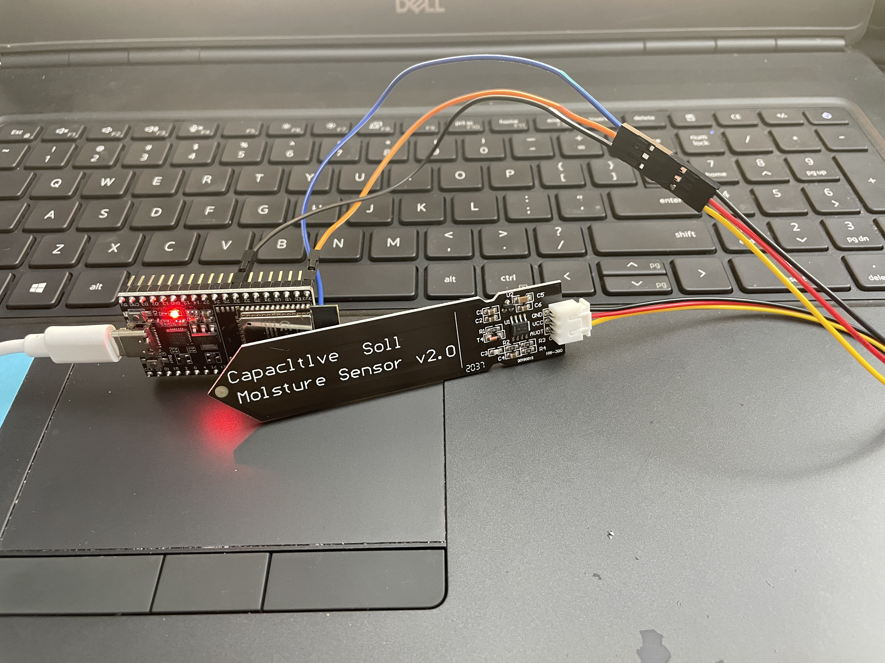
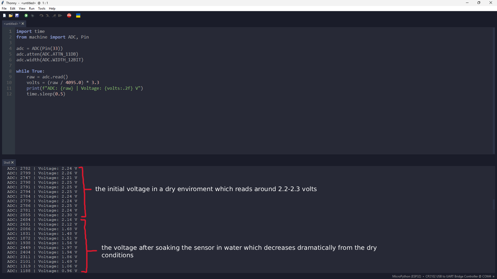

# Automated Plant Watering System

An early-stage plant watering project built around an esp32 microcontroller, moisture sensing, pump control, and a small status display[cite: 9].

## Current Hardware Parts
- ESP32 board[cite: 9]
- Soil moisture sensor[cite: 9]
- Water pump and tubing[cite: 9]
- Relay module[cite: 9]
- Small display screen[cite: 9]
- Breadboard and jumper wires[cite: 9]

## Current Status
Gathering and testing the core components before wiring everything together, writing the control logic, and building an enclosure[cite: 9].

## Initial Sensor Testing
Tested the Capacitive Soil Moisture Sensor v2.0 powered from the ESP32 (`3V3` and `GND`) with `AOUT` wired to `GPIO 33` and read in Thonny using MicroPython (`12-bit` ADC with `ATTN_11DB`)[cite: 7, 8].

### Wiring Setup

The sensor is connected to the ESP32 board over USB with `3V3`, `GND`, and `AOUT` (`GPIO 33`) wired via jumper cables to verify power and analog signal response[cite: 7, 8].

### Initial Test Results

In a dry environment, the sensor reads steady around **2.2–2.3 V** (`ADC` roughly `2747–2855`). When exposed to water, the voltage drops sharply (down to **0.96 V** / `ADC` `1188` in the capture), confirming the sensor responds to moisture[cite: 8].
